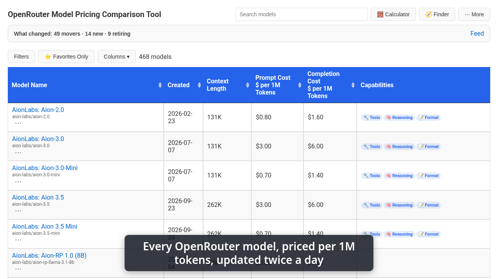
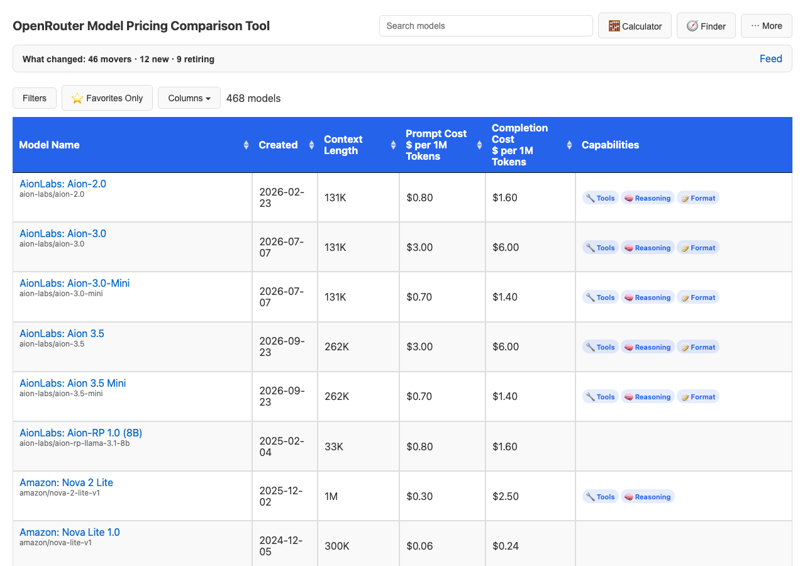
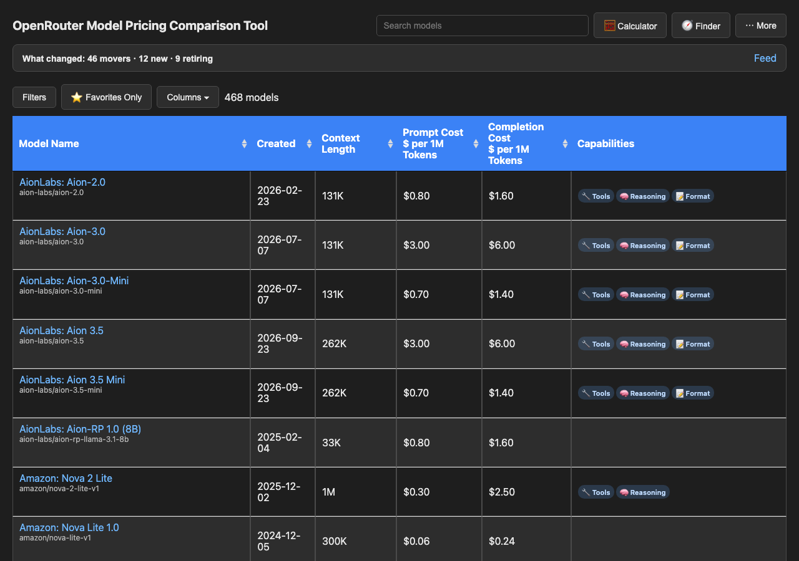
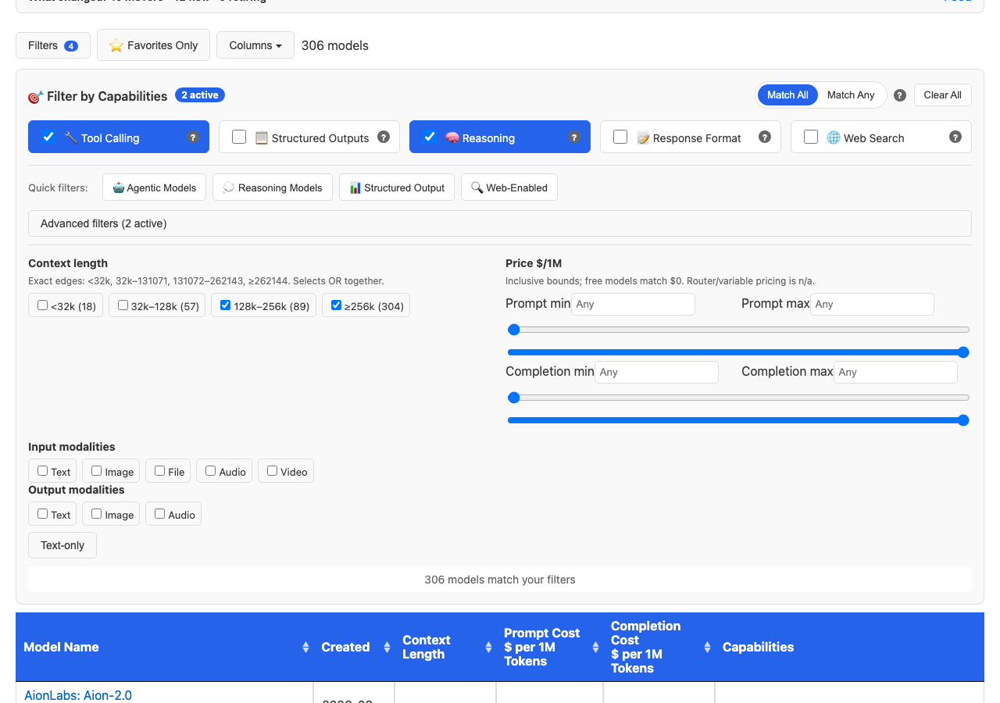
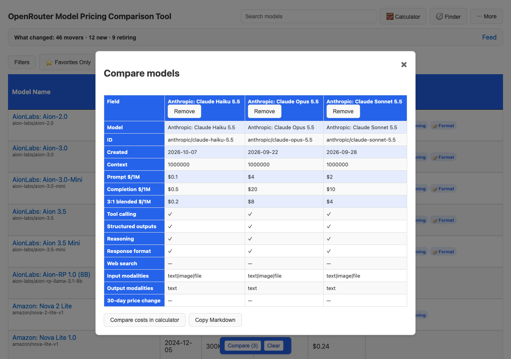
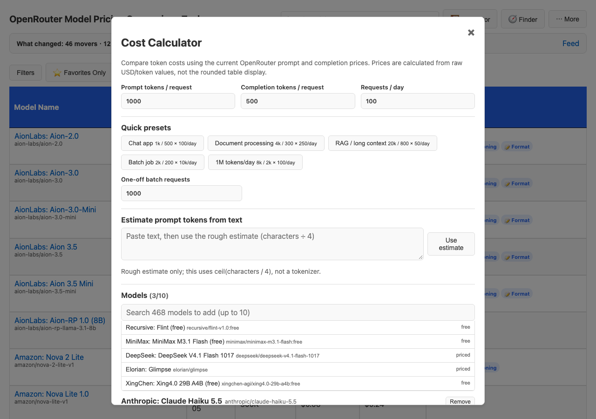
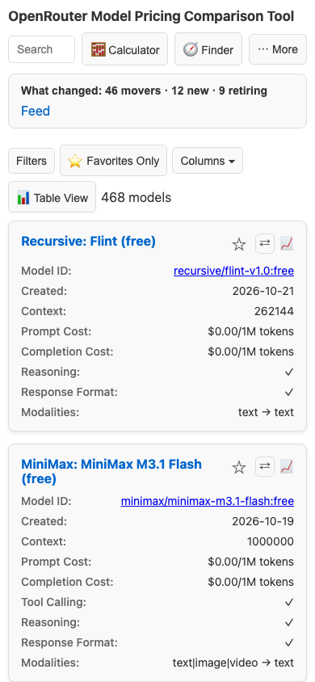
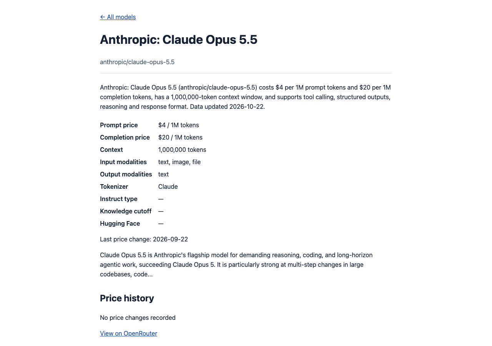
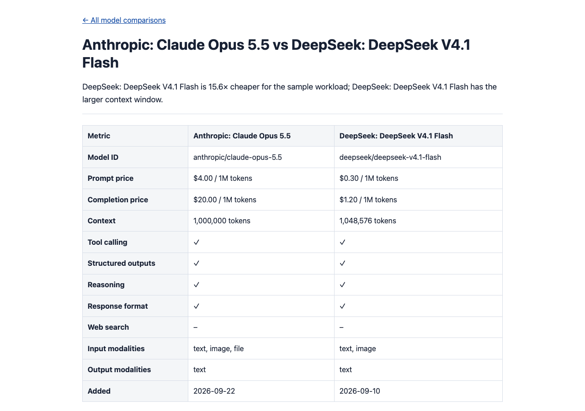

# OpenRouter Model Pricing Comparison Tool 🚀

[](https://choosealicense.com/licenses/mit/)
[](https://github.com/jvrck/openrouterlist/actions)
[](https://openrouterlist.jvrck.com/)

[OpenRouterList](https://openrouterlist.jvrck.com/) is a static pricing and capability comparison for the models available through the [OpenRouter API](https://openrouter.ai/). It currently covers 468 models and is updated at least twice a day for developers, researchers and teams choosing a model or estimating a workload.

## Demo

[](https://openrouterlist.jvrck.com/docs/media/demo.mp4)

[Watch the 57-second OpenRouterList demo](https://openrouterlist.jvrck.com/docs/media/demo.mp4).

## Features

### Find a model

- Search by model name or ID and filter by capabilities, context length, prompt or completion price, input and output modality, or text-only support. Filter state can be shared in the URL.
- Use Model Finder presets for support, coding, RAG, extraction, reasoning, web research and free models, then copy a curl, JavaScript or Python API snippet for the selected model.
- Switch between the desktop table and mobile-friendly Card View. The first 50 matches are shown, with **Show more** paging through the rest.
- Save favourites, choose light, dark or system theme, adjust display density, and use the built-in keyboard shortcuts (`?` opens the shortcut list).

### Compare and estimate

- Add up to four models to the compare tray for side-by-side prices, context, capabilities, modalities and 30-day price changes.
- Estimate prompt and completion costs for a request, day, 30-day month, 365-day year or one-off batch in the cost calculator, with up to ten models at once.
- Open static, shareable [`/compare/`](https://openrouterlist.jvrck.com/compare/) pages for popular pairs, including a sample workload comparison.

### Track changes

- Follow additions, removals and price changes in the on-page **What changed** strip or the [Atom price-changes feed](https://openrouterlist.jvrck.com/feed.xml).
- Open a model's price-history chart and 30-day change badges, or search the discontinued-model archive.
- Use each model's static [`/m/<model-id>/`](https://openrouterlist.jvrck.com/m/anthropic/claude-opus-5.5/) page for current prices, context, modalities, capabilities and tracked price history.

### Use the data

- Export the current view with Copy, CSV, Excel or Print.
- Give an agent [`llms.txt`](https://openrouterlist.jvrck.com/llms.txt) as a map of the site's data and pages.
- Read the documented, versioned [`/api/models.json`](https://openrouterlist.jvrck.com/api/) projection, sorted by model ID with per-million-token prices and explicit capability flags:

  ```bash
  curl -s https://openrouterlist.jvrck.com/api/models.json | jq '.models[] | select(.capabilities.tool_calling)'
  ```

## Screenshots

Light theme — the default pricing table with linked model names, exact IDs and capability badges.



Dark theme — the same live table in the dark colour scheme.



Filters — capability, context, price and modality controls with a live match count.



Compare — three models side by side in the interactive comparison.



Calculator — token and request inputs, workload presets and model selection.



Phone Card View — model details and actions at 390 px wide.



Model page — a static model summary with pricing and history.



Comparison page — a shareable static price comparison for a model pair.



## How the data updates

The [Daily Run workflow](.github/workflows/daily_run.yml) runs at 00:00 and 12:00 UTC, when manually dispatched, and on pushes to `main`. It fetches OpenRouter's public model list, builds the JSON and CSV snapshots, detects changes, updates the price-history ledger and change feed, and generates model pages, comparison pages and the documented API.

The GitHub Actions bot commits only when the working tree changed. Durable history lives in git and in [`data/history/prices.json`](data/history/prices.json); the timestamped zip made by the fetch script is a local, gitignored run artifact.

## Hosting

GitHub Pages serves the `main` branch at [openrouterlist.jvrck.com](https://openrouterlist.jvrck.com/) (custom domain via [`CNAME`](CNAME)); the domain is proxied through Cloudflare, which also adds cookieless Web Analytics at the edge. There is no server-side code.

## Data fields

The current table shows these columns. The Capabilities column combines five badges; see the [/api/ field reference](https://openrouterlist.jvrck.com/api/) for the full machine-readable field list, including modalities and expiration dates.

| Field | Description |
|---|---|
| **Model** | Model name linked to its static page, with the exact OpenRouter ID below |
| **Created** | Model creation date |
| **Context** | Maximum context window in tokens |
| **Prompt cost** | USD per 1M prompt tokens |
| **Completion cost** | USD per 1M completion tokens |
| **Capabilities** | Badges for Tool Calling, Structured Outputs, Reasoning, Response Format and Web Search |

## Quick start and local development

Clone the repository and install `jq`, `curl`, `zip` and Python 3. Run the fetcher from a scratch checkout because it calls the live API and can update tracked data:

```bash
git clone https://github.com/jvrck/openrouterlist.git
cd openrouterlist
bash ./scripts/get_zipped.sh
```

When OpenRouter's data changed, the script writes the current snapshots and generated outputs under `data/`, `m/`, `compare/` and `api/`. Every run also writes a timestamped zip under the local, gitignored `results/` directory.

Serve the static site locally from the repository root:

```bash
python3 -m http.server
```

Then open [http://localhost:8000/](http://localhost:8000/).

## Contributing

[Issues](https://github.com/jvrck/openrouterlist/issues) and pull requests are welcome. Keep each pull request to one focused change and add the corresponding patch entry to [`CHANGELOG.md`](CHANGELOG.md).

## License

This project is licensed under the MIT License — see [LICENSE](LICENSE).

## Related links

- [OpenRouter API](https://openrouter.ai/)
- [OpenRouter documentation](https://openrouter.ai/docs)
- [OpenRouter model pricing](https://openrouter.ai/models)

---

**Keywords**: OpenRouter pricing, AI model costs, LLM pricing comparison, Claude pricing, Llama pricing, AI API costs, model comparison tool, token pricing calculator, language model costs, OpenRouter models
